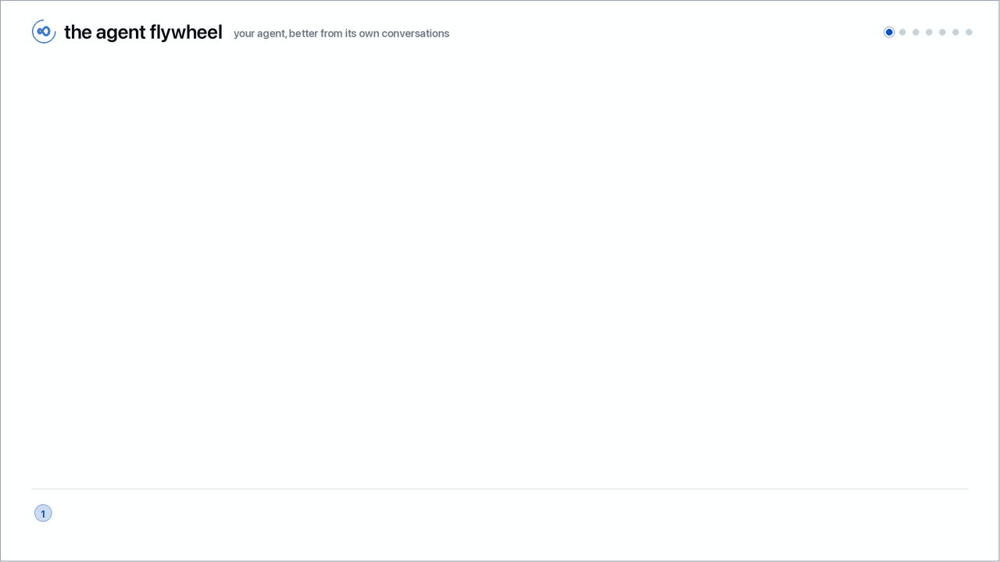
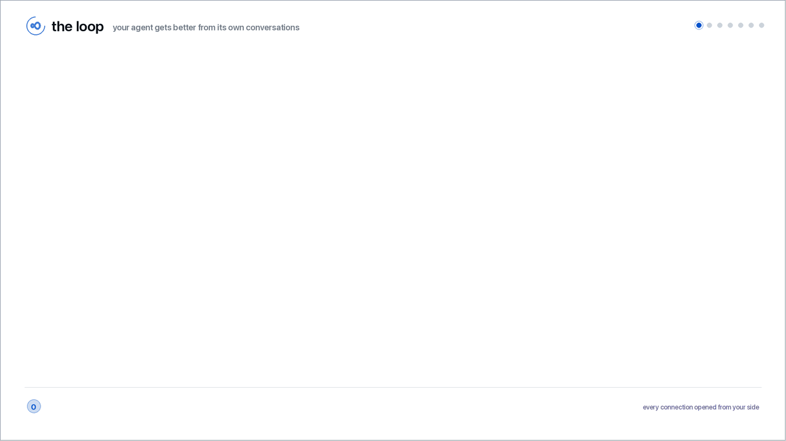

<div align="center">

<!-- lang -->
<!-- IMAGE PATHS ARE RELATIVE ON PURPOSE, and it is a one-way door while this
     repo is private. GitHub resolves a relative src against the repo you are
     already authenticated to, so these render. An absolute
     https://raw.githubusercontent.com/... src does NOT: raw.githubusercontent
     is fetched anonymously and does not carry your github.com session, so a
     PRIVATE repo answers 404 and every image on this page breaks -- for the
     owner too, looking at their own README. Verified 2026-09-06: all four
     raw.githubusercontent URLs a previous edit introduced returned 404, as did
     the repo page itself.

     This has now regressed TWICE, both times reasoning from PyPI: README.md is
     copied into PKG-INFO and relative paths do not resolve there. That is true
     and it is not the trade-off we are making. GitHub is the target surface for
     these figures while the repo is private. PyPI cannot resolve them, so its
     page shows their alt text instead -- and an absolute URL would not fix
     that, because it 404s for PyPI's readers exactly as it does for GitHub's.
     docs/assets/ is also deliberately excluded from both the wheel and the
     sdist (tests/test_packaging.py builds the real artifacts and asserts it).

     ON PUBLISH, and only once the repo is PUBLIC, absolute raw.githubusercontent
     URLs become correct and are then required for PyPI rendering. Public first;
     flipping these while the repo is private just breaks GitHub again.
     tests/test_readme_renders_on_github.py enforces the relative form and that
     every relative target exists.

     SHARED WITH THE NODE README. Everything outside the lang markers is the
     same text in both repositories, held by tests/test_shared_docs_match_node.py;
     only what sits between the markers is this SDK's own. -->

#  Agent Flywheel
<!-- /lang -->

Built and Maintained by **[PerceptEye](https://percepteye.ai)**

### **Your agent gets better at its own job, from its own conversations.**

Your agent keeps running where it runs today, on your credentials, unchanged. We learn from its real conversations, test each new version against its current best, and you approve the winner.

<!-- lang -->
<!-- BADGES — `ci` was a live shields.io badge and rendered as a red error
     image, because shields.io queries GitHub anonymously and this repo is
     PRIVATE, so GitHub's API 404s for an anonymous caller whatever
     .github/workflows/ci.yml — which does exist, and is pushed — actually did.
     Verified against the live service 2026-09-06.

     ONCE THE REPO IS PUBLIC restore it verbatim. Do not hand-write a
     "passing" into a static badge to fill the gap — that asserts a state
     nothing checks.
       [](https://github.com/percepteye-ai/agent-flywheel/actions)
     `pypi` is live and asks PyPI for the published version of
     `agent-flywheel`. PyPI answers anonymous callers, so unlike `ci` it
     renders while the repo is private, and it has shown the current release
     since 0.1.0 went out on 2026-09-14. This README is also each release's
     PyPI page, so it must never claim the package is unreleased.
     `ci` gets no static stand-in: the hardcoded `tests` badge below already
     carries what a reader wanted from it, and a README cannot assert its own
     pipeline state. That badge used to be hardcoded with nothing checking it,
     and it drifted: it read 695 while the suite was 749, and the Development
     section below said 695 while the docs site said 509. It is CHECKED now.
     tests/test_documented_counts_are_true.py re-derives the suite size and
     requires every published copy to match it, here and on the docs site, so
     editing one copy alone turns the suite red. Re-derive by hand with:
       .venv/bin/python -m pytest tests/ --collect-only -q -p no:warnings \
         | awk -F': ' '/^tests\/.*: [0-9]+$/{n+=$2} END{print n}'   # -> 1336 -->
[](https://pypi.org/project/agent-flywheel/)
[](pyproject.toml)
<br/>
[](pyproject.toml)
[](#-harnesses)
[](#-development)
[](LICENSE)


<!-- /lang -->

**[Quickstart](website/docs/quickstart.md)** · [How it gets better](#-how-it-gets-better) · [Start](#-start) · [OpenTelemetry push](website/docs/otlp.md) · [What reaches us](#-what-reaches-us) · [Docs](#-docs)

</div>

---

## 🔁 How it gets better

1. **We learn from your agent's real conversations.** The SDK records what your users asked, what the model saw, what the tools did and what your agent answered, and sends it to us once you allow it.
2. **Each new version is tested against your agent's current best,** on conversations it has never seen.
3. **You approve the winner in Decisions.** Nothing reaches your users before that.
4. **The next round starts from the best so far.** Run it again whenever new conversations have arrived.

No container to build, no cluster to run, no GPU to provision and no inbound port to open. Every connection is opened from your side.

## ⚡ Start

<!-- lang -->
```bash
pip install agent-flywheel        # one runtime dependency: httpx
```

```python
import agent_flywheel as fw

px = fw.attach(agent_id="support-agent", trajectory_root="/var/lib/percepteye")

with px.turn(conversation_id=conversation_id, input_text=user_text) as turn_id:
    reply = agent.invoke(user_text)          # your agent, unchanged
px.record_answer(turn_id, reply)
```
<!-- /lang -->

[Get your key](website/docs/dashboard.md#get-your-key), and put it in your agent's environment with the control-plane URL shown beside it:

```bash
export PERCEPTEYE_CONTROL_PLANE_URL=https://launch.percepteye.ai/api/flywheel/v1
export PERCEPTEYE_API_KEY=pefw_...
```

Start your agent, give it [permission to learn from its conversations](website/docs/dashboard.md#allow-us-to-learn-from-its-conversations), and [start improving](website/docs/dashboard.md#start-improving). The [Quickstart](website/docs/quickstart.md) walks through it, including when your first trace appears.

## 🧩 Harnesses

<!-- lang -->
| your agent | what the SDK records | your code |
|:--|:--|:--|
| **LangChain** · **LangGraph** · **Google ADK** | conversations, model calls, and every tool call's outcome | `attach()` at startup and `px.turn()` per turn; nothing inside your agent |
| **any command-line agent** | practice tasks; tool outcomes through an output adapter, or a line per call appended to the trajectory | `fw.serve(["my-agent", "run"], ...)`; nothing added to the binary |
| **prime-agent** *(optional example)* | practice tasks, with an explicit output adapter | [worked example →](examples/prime_agent/) |

Adapters bind every built-in whose framework is installed, and import nothing until they bind, so they add no dependencies.
<!-- /lang -->

Running something else that exports OpenTelemetry traces? [Push them](website/docs/otlp.md), with nothing to install.

## 📤 Already on OpenTelemetry?

Send us the traces your agent already exports, as a second destination. With an OpenTelemetry Collector you add us as one more exporter, and your current destination keeps receiving everything. → [OpenTelemetry push](website/docs/otlp.md)

## 🎯 Practice tasks

Your agent can also work through practice tasks we write from its own tools and system prompt, graded as it goes. You [start them](website/docs/dashboard.md#run-practice-tasks) from your agent's page.

<!-- lang -->
<p align="center">
  
</p>

```python
fw.serve("my_package.agent:build", agent_id="support-agent", input_shape="text", max_rollouts=8)
```

`serve()` rebuilds your agent from that import path in a fresh child process for each task, and reports what it did. `PERCEPTEYE_AGENT_MODE=production` makes it return at once, so one image can run in production unchanged. → [Python agents](website/docs/python.md#practice-tasks-serve)
<!-- /lang -->

## 🔒 What reaches us

- **Nothing, until you allow it.** Conversations are sent only once an organization admin switches on the agent's [permissions](website/docs/dashboard.md#allow-us-to-learn-from-its-conversations). Until then they stay on your disk.
- **Personal data is found, and never learned from.** We scan everything we receive. In tool-call records a match is masked; in messages and what the model saw, the turn is kept as sent and never learned from.
- **Nothing is deleted unless you ask**, and your own copy on your machine is yours. → [What data do you keep?](website/docs/faq.md#what-data-do-you-keep-and-for-how-long)
- **Never your code, and never your credentials.** Your agent runs where it runs today.

## ✋ A person approves every change

- **A new version reaches Decisions only after it has beaten your agent's current best** on conversations it has never seen. You approve it or reject it there; until you approve, your agent keeps the version it has.
- **No language model can approve anything.** Promoting a model and delivering a prompt are irreversible decisions: only the explicit approve and reject controls resolve them. A reply like "sure, go ahead" is recorded as an answer, never as an approval.
- **The SDK checks too.** It refuses a model whose address is a stored file (`gs://`, `s3://`, `file://`) rather than a running endpoint, and a prompt that a person did not approve or that was approved against a different model.

<!-- lang -->
The SDK never applies a model or a prompt for you: `policy_source()` hands back the approved endpoint, and `prompt_decision()` says whether the approved prompt may be applied. → [Production](website/docs/production.md#run-the-approved-version)
<!-- /lang -->

## 🐍 Python or Node?

Pick the one that matches where your agent runs. Never both for one agent.

| | Python SDK | Node plugin |
|:--|:--|:--|
| **for** | a Python agent, or a command-line agent you launch yourself | an OpenClaw or DeepSeek Harness agent |
| **install** | `pip install agent-flywheel` | `openclaw plugins install @percepteye/agent-flywheel` |
| **the approved model and prompt** | handed back for your code to apply | applied for you, in production mode |
| **repository** | [`agent-flywheel`](https://github.com/percepteye-ai/agent-flywheel) | [`agent-flywheel-node`](https://github.com/percepteye-ai/agent-flywheel-node) |

## ⚙️ Configuration

<!-- lang -->
| variable | meaning |
|:--|:--|
| `PERCEPTEYE_CONTROL_PLANE_URL` | the control-plane URL; defaults to `https://launch.percepteye.ai/api/flywheel/v1`, as in the Node SDK |
| `PERCEPTEYE_API_KEY` | your agent's key |
| `PERCEPTEYE_AGENT_MODE` | `training` (the default) or `production`; gates `serve()` only |
| `PERCEPTEYE_INTROSPECT` | `0` sends no description of your agent |
| `PERCEPTEYE_TRAJECTORY_DIR` | one explicit trajectory directory, for a single run |

The first two can be passed in code as `control_plane_url=` and `api_key=`. Every argument of `attach()` and `serve()` is in [Python agents](website/docs/python.md) and [Configuration](website/docs/configuration.md).
<!-- /lang -->

## 📚 Docs

- [Quickstart](website/docs/quickstart.md): from install to your first trace, then to improving.
- [Production](website/docs/production.md): what is sent and when, retries, rate limits and personal data.
- [OpenTelemetry push](website/docs/otlp.md): send the traces your agent already exports.
- [In the dashboard](website/docs/dashboard.md): every click path, in one place.
- [FAQ](website/docs/faq.md) and [Troubleshooting](website/docs/troubleshooting.md).
<!-- lang -->
- [Python agents](website/docs/python.md), [How the loop closes](website/docs/how-it-works.md), [Outcomes](website/docs/outcomes.md), [Configuration](website/docs/configuration.md) and [the contract](website/docs/contract.md): the reference, also built as a site from [`website/`](website/).
<!-- /lang -->

## 🛠 Development

<!-- lang -->
```bash
python -m venv .venv
.venv/bin/pip install -e ".[dev,adapters-test,otel,otel-test]"
.venv/bin/pytest
./scripts/cross_language_abi_check.sh     # the cross-language contract, both ways
```

The last one is **not** the Node package's own suite — that lives in the [Node repository](https://github.com/percepteye-ai/agent-flywheel-node) and runs there with `npm test`. This drives records through the Node writer and asserts the Python `Trajectory` reads them back with the same meaning, which is the half only this repo can check. **It needs a Node checkout**: point `PERCEPTEYE_NODE_SDK` at one, or keep it as a sibling directory. Without one it prints `SKIPPED` and exits 0, and the cross-language tests in the suite above skip with it.

1336 tests, and CI permits **zero skips** — a skipped test and a passing test look identical in a green check mark. CI names `PERCEPTEYE_NODE_SDK` and `PRIME_AGENT_PACKAGE_ROOT` and installs both, so neither the cross-language half nor the tests that execute the real `prime-agent` binary can go green by skipping there. Other jobs assert that a bare install still works on Python 3.10→3.13, that the runtime dependency list never grows past `httpx`, and that the Node plugins never drift from the Python reader.

[`schema/flywheel-1.json`](schema/flywheel-1.json) is the wire contract and this repository owns it. Absence is never collapsed into zero: `tool_calls=None` means "I did not report tool calls"; `[]` means "I observed zero", a positive claim. The animations above are generated, not drawn — [`docs/assets/render.sh`](docs/assets/render.sh) rebuilds them.
<!-- /lang -->

---

**Contributing** — issues and PRs welcome; a new adapter must not import its framework at module scope, must report `unknown` rather than guess, and must fail loudly at bind time. ·
**Security** — please report vulnerabilities privately to **security@percepteye.ai**. ·
**License** — [MIT](LICENSE) © PerceptEye.
