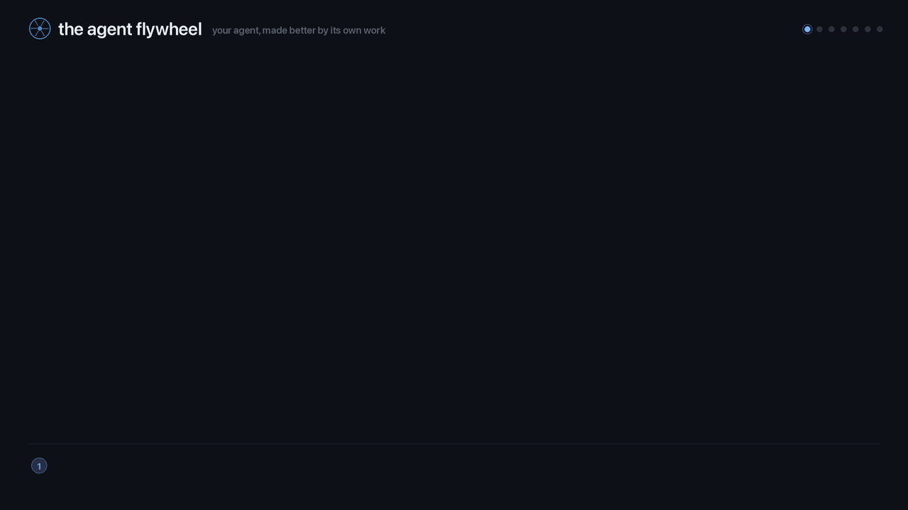
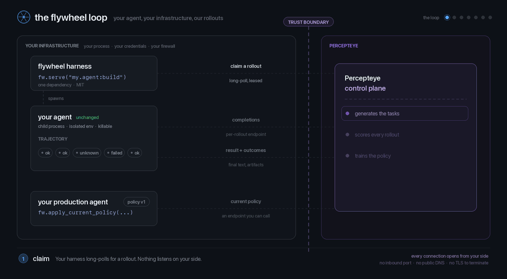

<div align="center">

<!-- IMAGE PATHS ARE RELATIVE ON PURPOSE, and it is a one-way door while this
     repo is private. GitHub resolves a relative src against the repo you are
     already authenticated to, so these render. An absolute
     https://raw.githubusercontent.com/... src does NOT: raw.githubusercontent
     is fetched anonymously and does not carry your github.com session, so a
     PRIVATE repo answers 404 and every image on this page breaks -- for the
     owner too, looking at their own README. Verified 2026-09-06: all four
     raw.githubusercontent URLs a previous edit introduced returned 404, as did
     the repo page itself.

     This has now regressed TWICE, both times reasoning from PyPI: README.md is
     copied into PKG-INFO and relative paths do not resolve there. That is true
     and it is not the trade-off we are making. GitHub is the target surface for
     these figures, the package is not published, and docs/assets/ is
     deliberately excluded from both the wheel and the sdist
     (tests/test_packaging.py builds the real artifacts and asserts it), so
     there is no shipped artifact for an absolute URL to help.

     ON PUBLISH, and only once the repo is PUBLIC, absolute raw.githubusercontent
     URLs become correct and are then required for PyPI rendering. Public first;
     flipping these while the repo is private just breaks GitHub again.
     tests/test_readme_renders_on_github.py enforces the relative form and that
     every relative target exists. -->

#  percepteye-agent-flywheel

### **Your agent gets better at its own job. You don't run any of the training.**

Ship one line. Your agent keeps running in your process, behind your firewall, on your credentials — **unchanged** — and the model it calls keeps improving.

<!-- BADGES — `ci` and `pypi` were live shields.io badges and both rendered as red
     error images, because shields.io queries these services anonymously and
     neither can answer: this repo is PRIVATE, so GitHub's API 404s for an
     anonymous caller whatever .github/workflows/ci.yml — which does exist, and
     is pushed — actually did, and the package is not on PyPI. Both verified
     against the live services 2026-09-06.

     ON PUBLISH restore these two verbatim: `pypi` once the package is on PyPI,
     `ci` only once the repo is public. Do not hand-write a version, or a
     "passing", into a static badge to fill the gap — that asserts a state
     nothing checks.
       [](https://github.com/percepteye-ai/agent-flywheel/actions)
       [](https://pypi.org/project/percepteye-agent-flywheel/)
     `ci` gets no static stand-in: the hardcoded `tests` badge below already
     carries what a reader wanted from it, and a README cannot assert its own
     pipeline state. That badge used to be hardcoded with nothing checking it,
     and it drifted: it read 695 while the suite was 749, and the Development
     section below said 695 while the docs site said 509. It is CHECKED now.
     tests/test_documented_counts_are_true.py re-derives the suite size and
     requires every published copy to match it, here and on the docs site, so
     editing one copy alone turns the suite red. Re-derive by hand with:
       .venv/bin/python -m pytest tests/ --collect-only -q -p no:warnings \
         | awk -F': ' '/^tests\/.*: [0-9]+$/{n+=$2} END{print n}'   # -> 973 -->
[](#-development)
[](pyproject.toml)
<br/>
[](pyproject.toml)
[](#-zero-instrumentation-concretely)
[](#-development)
[](LICENSE)



**[Start in one call](#-start-in-one-call)** · [Harnesses](#-harnesses-supported) · [How the loop closes](#-how-the-loop-closes) · [Training vs production](#-two-modes-one-image) · [Production capture](#-production-observability) · [Docs](website/docs/)

</div>

---

##  A continual-learning loop around the agent you already have

Your agent already does real work. **This turns that work into training data, and delivers what it learns back as an endpoint your agent already calls.**

That is the whole product. Not a dashboard you read, not a benchmark you run — a loop that closes on its own and leaves your agent measurably better than the one you deployed.

| you get | what it actually means |
|:--|:--|
| 📈 **An agent that improves in place** | a policy trained on *this* agent's own trajectories — its prompt, its tools, its failure modes — not a generic model |
| 🤖 **Post-training you never operate** | task generation, grading, reinforcement learning, promotion gates: run by the control plane, on our GPUs |
| 🧠 **A prompt that improves too** | training co-optimizes the system prompt and ships the approved one back beside the model |
| 🔭 **Honest evidence** | every tool call is recorded as `ok`, `failed`, or `unknown` — the third is legal, expected, and never rounded up to `ok`, so a verifier abstains instead of learning from a lie |
| 🔒 **Nothing moves** | no container, no cluster, no GPU, no inbound port; every connection is dialled out from your side |

**And you can watch every lap.** The control plane is the part you don't build — not a part you can't see. Sign in and the tasks it generated, how each rollout scored, and what got promoted are all there to inspect.

## ⚡ Start in one call

```bash
pip install percepteye-agent-flywheel      # one runtime dependency: httpx
```

> [!NOTE]
> **Not on PyPI yet** — that command does not resolve today, and the grey badge
> above is the only other place this is said. Until the first release, install
> from source (you need access to the repository):
> `pip install "git+ssh://git@github.com/percepteye-ai/agent-flywheel.git"`

```python
import percepteye_agent_flywheel as fw

fw.serve("my_package.agent:build", agent_id="my-coding-agent", input_shape="text")
```

**That is the integration.** You pass an importable `"module:attr"` factory so each rollout can rebuild your agent in a fresh child process. `serve()` claims rollouts, runs them, reports outcomes, and blocks until you stop it.

It needs two things from the environment — there is no baked-in address:

```bash
export PERCEPTEYE_CONTROL_PLANE_URL=https://launch.percepteye.ai/api/flywheel/v1
export PERCEPTEYE_API_KEY=pefw_...        # issued by whoever operates your control plane
```

Either one missing and `serve()` raises before the first rollout, naming it.

Everything that can be misconfigured — entrypoint, credential, contract version, isolation mode — is checked **before the first rollout** and raises there, never mid-run.

<!-- SIGNUP ROUTE STILL NEEDED — owner action. There is no self-service signup,
     no key-request form and no "request access" endpoint anywhere in either SDK
     repo; grep for one before assuming otherwise. support@percepteye.ai below is
     the only non-security address either repo contains (the sibling Node README
     is its single occurrence — it is uncorroborated by any code, config, DNS or
     docs page here), and it is used because the Node README already gives it and
     both SDKs must answer this question identically. Replace this paragraph with
     the real route once it exists, in BOTH READMEs. Do not invent one, and do
     not link a host that has not been resolved: docs.percepteye.ai was linked
     here and does not resolve (checked 2026-09-06). -->

**Where a `pefw_` key comes from:** it is issued by whoever operates your Percepteye control plane — ask them, or write to **support@percepteye.ai**. There is no self-service page to sign up on, and this README deliberately does not point you at one.

> [!TIP]
> Rollouts are real runs on your real credentials. Bound the first one with `max_rollouts=8` and point `artifacts_dir=` somewhere you don't mind it writing. `max_rollouts` is also the only clean exit: there is no signal handler, and Ctrl-C drains in-flight rollouts first.

### Your agent is a binary? Three commands.

**goose loads a plugin**, so there is no `import` to add and nothing to run alongside it — no worker, no sidecar, no wrapper process. (Every other binary goes through `fw.serve([...])` below, which *is* a process you run.)

```bash
pip install percepteye-agent-flywheel     # 1. the wheel
percepteye install-hooks                  # 2. register the plugin with goose
goose session                             # unchanged. That is the point.
```

**That is the whole install, and it needs no account.** The plugin records your agent's real tool-failure rate to `~/.percepteye/turns/`; nothing leaves the machine — no key, no network, useful on day one. `percepteye report` prints what it found. `PERCEPTEYE_CAPTURE=0` turns recording off.

**To also contribute rollouts, add both of these** — a key alone claims nothing, because this package bakes in no control-plane address:

```bash
export PERCEPTEYE_CONTROL_PLANE_URL=https://launch.percepteye.ai/api/flywheel/v1
export PERCEPTEYE_API_KEY=pefw_...        # issued by whoever operates your control plane
```

`percepteye status` says which of the two is missing rather than leaving you to guess.

Any other CLI is an argv list — no protocol to implement, no change to the binary:

```python
fw.serve(["opencode", "run"], agent_id="coding-agent", input_shape="text")
```

The task arrives on **stdin** and as `PERCEPTEYE_TURN_INPUT`; ordinary **stdout** is the final text. Structured JSONL is interpreted only when you pass an explicit `command_output_adapter`, so core never guesses a customer's event vocabulary. Mark an argv position with `fw.TASK` if your CLI takes the task as an argument. `percepteye status` prints where traffic will actually go on the next run.

## 🧩 Harnesses supported

| harness | surface | integration |
|:--|:--|:--|
| **LangChain** · **LangGraph** · **Google ADK** | 🐍 Python | adapter auto-binds — **zero code in your agent** |
| **goose** | ⌘ CLI | `percepteye install-hooks` — no worker, no sidecar |
| **opencode** | ⌘ CLI | `fw.serve(["opencode", "run"], ...)` — nothing added to the binary |
| **prime-agent** *(optional example)* | ⌘ CLI | argv + explicit `PrimeAgentOutputAdapter` — **[worked example →](examples/prime_agent/)** |
| **any structured CLI** | ⌘ CLI | provide a `CommandOutputAdapter`; the generic `StreamFormat` parser can reconcile tool lifecycles |

Adapters are on by default (`adapters="auto"`) and bind every built-in whose framework is installed. No adapter imports its framework until you bind it, so they add **zero dependencies**. Shipping your own is one entry-point factory in the `percepteye_agent_flywheel.adapters` group.

The command adapter is explicit and optional. Capture from it survives clean exits, non-zero exits and timeout kills — a rollout that died is exactly the one you need the tool calls from. With no adapter, structured stdout remains ordinary stdout and makes no telemetry or model-call-count claim.

*Running OpenClaw or DeepSeek Harness?* Those are the Node plugin → [`percepteye-ai/agent-flywheel-node`](https://github.com/percepteye-ai/agent-flywheel-node).

## 🔁 How the loop closes

<p align="center">
  
</p>

**Register once, then loop forever.** Every lane crosses the trust boundary **outbound, opened from your side**.

| beat | what happens | who does the work |
|:--|:--|:--|
| **⓪ Onboard** | the SDK describes your agent from inside its own process and registers it — once, before the first rollout | automatic; `introspect=False` opts out |
| **① Claim** | your process long-polls for a rollout; leases heartbeat, crashed workers redeliver | you dial out |
| **② Run** | fresh child process, own environment, single-use credential, own trajectory | your agent, unchanged |
| **③ Record** | every tool call lands as `ok` / `failed` / `unknown`; artifacts collected on every path | adapters, from the outside |
| **④ Score & train** | tasks generated from your real tool surface, graded against compiled checks, then trained | **Percepteye — you build none of it** |
| **⑤ Improve** | your production agent picks up the promoted policy; the next lap runs on the better agent | one call at startup |

That last beat is what makes it a flywheel rather than a pipeline: **the better agent generates the better evidence.**

Beat ⓪ is why you never write a task list. Tasks come from **the tool surface you actually have** — read after templating and conditional registration, so it is the prompt your agent really assembled, the tools it really registered, the sub-agents it really built. A CLI agent with no object to read is warmed up once, well under a second, and described from that.

## 🎚 Two modes, one image

One variable decides whether a deployment does training work. The same container does either, with no code edit.

```bash
PERCEPTEYE_AGENT_MODE=training      # the default when unset
PERCEPTEYE_AGENT_MODE=production
```

| | `training` | `production` |
|:--|:--|:--|
| **pick it for** | a machine you're happy to lend to rollouts | the deployment serving your users |
| `fw.serve(...)` | claims and runs rollouts | returns `0` immediately, **before opening any connection** |
| `percepteye install-hooks` | endpoint → our gateway, so completions are captured — **only once `PERCEPTEYE_API_KEY` and `PERCEPTEYE_LLM_BASE_URL` are both set**; with either missing it says so and leaves your routing alone | endpoint → **the one you had**, restored verbatim |
| needs a URL and key | yes | no |

`production` restores the endpoint value *you* had, not a default we picked — read once, before we ever write to your config, and kept across upgrades. An unrecognised value **raises** rather than guessing: a typo that silently picked `training` would keep spending your credentials with nothing printed. (`train`, `rollout`, `fine-tuning` also mean contribute; `prod` and `serving` mean don't. `mode=` in code beats the variable, and the printed line says when that happened.)

> [!IMPORTANT]
> The switch gates **`serve()`** — the call that does training work. It does not gate `attach()` — that *is* the production surface. Gating both would mean the correct setting for a production agent was `training`.

**Contribute nothing, still get the trained model.** No `serve()`, no `attach()`, no registration:

```python
kw = fw.apply_current_policy(agent_id="my-agent")
if kw:                                   # {} means keep your current config
    client = OpenAI(base_url=kw["base_url"], api_key=kw["api_key"])
    model = kw["model"]

served = fw.current_prompt(agent_id="my-agent")          # the approved prompt
decision = fw.prompt_decision(served)                   # may I apply it?
if decision.apply:
    system_prompt = decision.text
else:
    log.info("keeping the current prompt: %s", decision.reason)

src = fw.policy_source(agent_id="my-agent", on_change=reconfigure)
snap = src.current()                     # per turn; between refreshes it's a cache read
```

**Nothing polls in the background.** The refresh runs inside your call — no timer, no poller — so a promotion *or a rollback* reaches production with no redeploy. After its first success `policy_source()` keeps serving the last good policy, so a network blip can never silently demote production back to the untrained model.

`prompt_decision()` is the whole rule in one call, and the SDK never applies a prompt for you: it checks that a prompt is actually being served, that your own baseline prompt has not changed since the pair was certified, that the bundle's status is one a person approved, and that the prompt's identity matches the checkpoint it was certified against. `apply` is false unless all four hold, `reason` says which one failed, and `text` is `None` rather than `""` — so a refusal can never blank the instructions your agent is already running on. The Node SDK asks the identical question, and [`tests/test_prompt_decision_parity.py`](tests/test_prompt_decision_parity.py) drives one table of cases through both implementations and asserts every field of the answer agrees.

## ✋ Nothing reaches your users until a person approves it

**Both halves of an improvement — the model and the prompt — require a human decision.** Not a threshold, not a scheduler, not a language model reading a report and deciding it looks good.

**The model.** Your agent keeps serving the model it is on today — the **champion** — until *all three* of these are true, and every one of them fails closed back to it:

1. **A person with the operator role moves that agent onto the candidate**, from the dashboard. It is an explicit, role-gated call on that one agent. No promotion applies it, no percentage rollout applies it, and there is no automatic path to it — moving *back* is the same call with the other value, which is what makes rollback fast enough to use during an incident.
2. **The candidate's certification did not go against it.** A verdict of *regressed*, *inconclusive* or *escalated* makes it unservable — the same set the promotion gate itself refuses on, so a candidate your agent could be moved onto is one that gate would also have accepted.
3. **It is genuinely deployed somewhere your agent can call.** An address that is a stored artifact rather than a running endpoint — a bucket or file path — is refused, so an approved candidate that nobody has served yet keeps the champion in place instead of pointing your agent at something that answers nothing. **The SDK re-checks this itself** rather than trusting the answer: `endpoint_kwargs()` — the one place a served policy becomes client arguments, and what both `apply_current_policy()` and `policy_source()` go through — returns `{}` and logs why, on the same prefix set the Node SDK refuses on. [`tests/test_served_model_is_servable.py`](tests/test_served_model_is_servable.py) drives both implementations and asserts the two agree.

**The prompt** is a separate chain with its own approval: the control plane serves a prompt only from a delivery a person approved, and `prompt_decision()` above re-checks that status on your side before anything is applied.

**And no language model can grant either approval.** Promoting a model, delivering a prompt pair, and promoting a research result are all marked irreversible in the approval system: only the explicit approve or reject control can resolve them. A model reading free-form text and interpreting "sure, go ahead" as consent is recorded as *answered* and never as *approved*, so it cannot promote, deliver, or roll anything out.

## 🔭 Production observability

`attach()` records the turns you are **already serving** — same adapters, same tri-state outcomes, same trajectory format as a rollout.

```python
px = fw.attach(agent_id="support-agent", trajectory_root="/var/lib/percepteye")

with px.turn(task_id=case_id, conversation_id=conv_id,
             input_text=user_text) as turn_id:
    reply = agent.invoke(user_text)      # your agent, unmodified

px.record_answer(turn_id, reply)         # after the scope closes — the answer exists now
```

**It captures. It never reroutes.** Adapters bind with no endpoint at all, so attaching cannot re-point a single byte of production traffic. Everything fails open: an unreachable control plane costs you the observation and nothing else.

For identity-bound production analysis, pass the same live Python agent as
`execution_entrypoint=` together with adapter-authored
`attested_execution_components`. The SDK emits
`agent_fingerprint.execution_sha256` only when its prompt/tools/model/sub-agent
discovery is exact and the opaque component evidence is valid; otherwise the
field stays absent. It is persisted per turn and projected to OTel as
`percepteye.agent.execution_sha256`. `attach()` does not claim a policy identity:
the policy it reads is informational and does not prove what your application ran.

`task_id=` is optional, opaque correlation evidence for your own case, job, or
work item. The SDK persists it, includes it in the turn upload, and projects it
as `percepteye.task.id`; it does not interpret the value or generate advice.
Supplying it grants no training eligibility. Control-plane clustering and
dataset services validate any later trace-to-task binding.

> [!IMPORTANT]
> **Upload is opt-in per agent and off by default.** A production turn is your end user's message and the answer you gave them, so nothing is sent until an operator enables capture for that agent. Until then turns accumulate as trajectory directories under the `trajectory_root` you named and go nowhere.
>
> **No restart needed to enable it.** While the answer is no, the SDK re-reads the verdict on its flush cadence and starts uploading as soon as an operator says yes. `px.may_upload` is the live answer; `px.upload_refusal` is the sentence explaining a `False`.

`input_text=` and `record_answer()` are the two lines that carry text, and both are yours to pass — adapters observe tool calls, not turn content. Once capture is on, uploading is automatic: answered turns go every 32 turns on a short-lived daemon thread, and an `atexit` hook sends the rest. Uploads never raise into your process and never block a turn on the network.

Production turns are **graded advisory, always** — they were produced by whatever you run, so they inform training rather than being scored as rollouts are. Training capacity still comes from `serve()`.

## 🧪 Zero instrumentation, concretely

This LangChain agent contains no reference to Percepteye of any kind:

```python
# lc_agent.py — your existing agent, untouched
from langchain_core.tools import tool

@tool
def lookup(q: str) -> str:
    """Look something up."""
    return f"found: {q}"

class Agent:
    tools = [lookup]
    def invoke(self, task: str) -> str:
        return str(lookup.invoke({"q": task}))

def build():
    return Agent()
```

Served with the two-line `fw.serve()` integration from [Start in one call](#-start-in-one-call), the rollout reports:

```json
"tool_calls": [{"name": "lookup", "arguments": {"q": "count to three"},
                "outcome": "unknown", "status_code": null,
                "output": "found: count to three", "latency_ms": 0.199}]
```

**Not one Percepteye import produced that record**, and it is enforced by [`tests/test_zero_instrumentation.py`](tests/test_zero_instrumentation.py). One `record_tool_call` where you *do* know the answer gets you the rest:

```python
from percepteye_agent_flywheel import record_tool_call

record_tool_call("charge_card", {"amount": 4200}, outcome="ok", status_code=201)
```

## ⚙️ Configuration

| variable | meaning |
|:--|:--|
| `PERCEPTEYE_CONTROL_PLANE_URL` | control-plane base URL. **No default** — unset means nothing is claimed and no trained policy is read, and every call that needed it now says so |
| `PERCEPTEYE_API_KEY` | your flywheel key |
| `PERCEPTEYE_AGENT_MODE` | `training` (default) or `production` — [one switch, both ways](#-two-modes-one-image) |
| `PERCEPTEYE_INTROSPECT` | `0` disables agent discovery |
| `PERCEPTEYE_LLM_BASE_URL` | the gateway `install-hooks` routes a `training` install at. Unset leaves your endpoint untouched |
| `PERCEPTEYE_CAPTURE` | `0` stops the goose plugin recording tool outcomes |
| `PERCEPTEYE_HOME` | where the plugin records when nothing else says (default `~/.percepteye`) |
| `PERCEPTEYE_AGENT_ID` | the agent the goose plugin reports as (default `goose`) |
| `PERCEPTEYE_TRAJECTORY_DIR` | one explicit trajectory directory, for a single run |

Three of them change behaviour; the rest are addresses, credentials and locations, and the first two are overridable in code as `control_plane_url=` and `api_key=`. `serve()` also takes `isolation` (`"subprocess"` is the default and the only mode with a real timeout), `concurrency`, `method`, `rollout_timeout_s`, `execution_snapshot` (a generic adapter-owned prepare/attest/release lifecycle), `attested_execution_components` (opaque adapter-owned SHA-256 evidence for exact OPSD execution identity), and `on_event` for a synchronous event callback — `claim_empty` versus `claim_failed` is how you tell an empty queue from a broken route.

**Your agent must sample through an OpenAI-compatible client**, because the per-rollout gateway speaks that API. Provider variables we cannot point at it are stripped from the child, and `serve()` warns at startup if it finds any.

<details>
<summary><b>Agent discovery</b> — what is sent, and how to turn it off</summary>

<br/>

Once at startup the SDK reads the *shape* of the agent you handed `serve()`: system prompt (the registration projection is truncated at 20k, while an available full observation is hashed before projection), tool names/descriptions/JSON Schemas, provider and model name, sub-agents to depth 4, and the framework matched. **Never sent:** your tools' source or return values, your credentials, your data, or anything observed during a rollout. Turn it off with `fw.serve(..., introspect=False)` or `PERCEPTEYE_INTROSPECT=0` — and only a deliberate value (`0`, `false`, `no`, `off`) disables it, so a typo leaves it on. Disabled, unreadable, or lossy discovery produces no affirmative `agent_fingerprint.execution_sha256`, so an OPSD consumer fails closed.
</details>

<details>
<summary><b>OpenTelemetry</b> — optional, egress only</summary>

<br/>

`pip install "percepteye-agent-flywheel[otel]"` and every outcome is additionally emitted as a span, so it lands in whatever you already run. The extra is the **API only, never the SDK**: this package emits into your registered `TracerProvider` and never installs one. Spans carry the GenAI semantic conventions plus `percepteye.tool.outcome`, and an `unknown` leaves the span status unset.
</details>

## 🛠 Development

```bash
python -m venv .venv
.venv/bin/pip install -e ".[dev,adapters-test,otel,otel-test]"
.venv/bin/pytest
./scripts/cross_language_abi_check.sh     # the cross-language contract, both ways
```

The last one is **not** the Node package's own suite — that lives in the [Node repository](https://github.com/percepteye-ai/agent-flywheel-node) and runs there with `npm test`. This drives records through the Node writer and asserts the Python `Trajectory` reads them back with the same meaning, which is the half only this repo can check. **It needs a Node checkout**: point `PERCEPTEYE_NODE_SDK` at one, or keep it as a sibling directory. Without one it prints `SKIPPED` and exits 0, and the cross-language tests in the suite above skip with it.

973 tests, and CI permits **zero skips** — a skipped test and a passing test look identical in a green check mark. CI names `PERCEPTEYE_NODE_SDK`, so the cross-language half cannot go green by skipping there. Other jobs assert that a bare install still works on Python 3.10→3.13, that the runtime dependency list never grows past `httpx`, and that the Node plugins never drift from the Python reader.

[`schema/flywheel-1.json`](schema/flywheel-1.json) is the wire contract and this repository owns it. Absence is never collapsed into zero: `tool_calls=None` means "I did not report tool calls"; `[]` means "I observed zero", a positive claim. The animations above are generated, not drawn — [`docs/assets/render.sh`](docs/assets/render.sh) rebuilds them.

---

**Contributing** — issues and PRs welcome; a new adapter must not import its framework at module scope, must report `unknown` rather than guess, and must fail loudly at bind time. ·
**Security** — please report vulnerabilities privately to **security@percepteye.ai**. ·
**License** — [MIT](LICENSE) © Percepteye.
