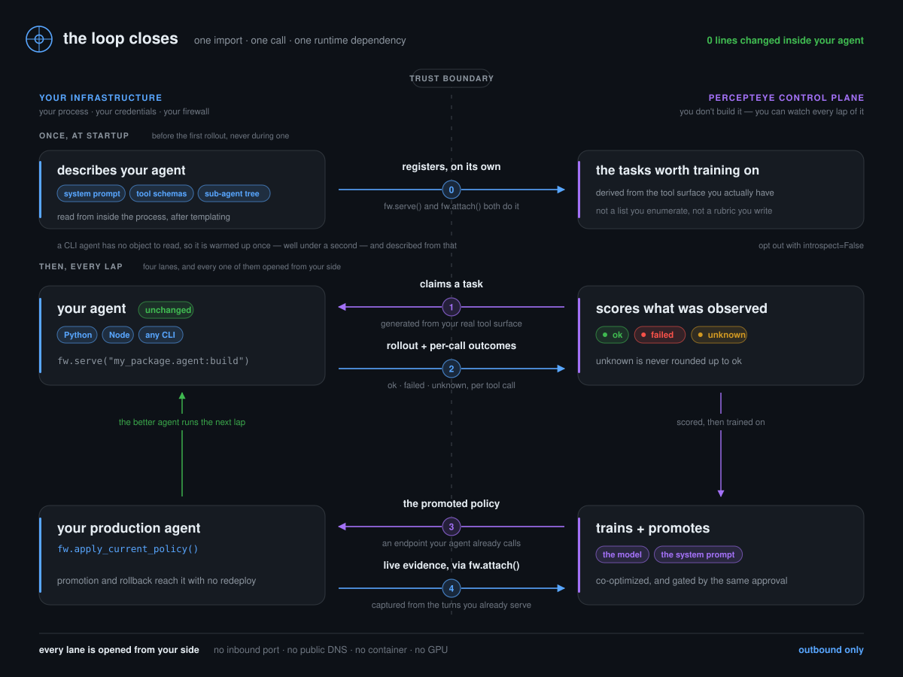

---
hide:
  - navigation
  - toc
---

continual learning for agents already in production

# Your agent, made better by its own work

<code>agent-flywheel</code> turns the work your agent already does into training
data, and delivers what it learns back as an endpoint your agent already calls. It runs
in your process, behind your firewall, on your credentials — unchanged.

[Quickstart](quickstart.md){ .fw-btn .fw-btn--primary }
[How the loop closes](how-it-works.md){ .fw-btn .fw-btn--ghost }

pip install agent-flywheel · one runtime dependency · MIT

0

lines changed inside your agent

1

runtime dependency (<code>httpx</code>)

0

inbound ports, containers, GPUs

1296

tests, zero skips permitted

## Start here

<a class="fw-card" href="quickstart/">
  

🚀

  

    <h3>Quickstart</h3>
    
One import, one call. Serve your first rollout in about two minutes, bounded so it cannot surprise you.

    
Get started

  

</a>

<a class="fw-card" href="how-it-works/">
  

🎡

  

    <h3>How the loop closes</h3>
    
Onboard once, then four lanes across a trust boundary — every one of them opened from your side.

    
See the architecture

  

</a>

<a class="fw-card" href="outcomes/">
  

🎯

  

    <h3>Outcomes</h3>
    
Every tool call is <code>ok</code>, <code>failed</code> or <code>unknown</code> — and <code>unknown</code> is never rounded up.

    
Why this matters

  

</a>

<a class="fw-card" href="python/">
  

🐍

  

    <h3>Python agents</h3>
    
LangChain, LangGraph and Google ADK report per-call outcomes with no Agent Flywheel code in your agent.

    
Bind an adapter

  

</a>

<a class="fw-card" href="node/">
  

📦

  

    <h3>Node harnesses</h3>
    
One npm package covering OpenClaw and DeepSeek Harness. Zero dependencies, and inert until you switch it on.

    
Install the plugin

  

</a>

<a class="fw-card" href="cli/">
  

⌨️

  

    <h3>CLI and other languages</h3>
    
Not Python? Pass an argv list. There is no protocol to implement, so an existing CLI needs no changes.

    
Serve a binary

  

</a>

## The loop, in one figure

**Register once, then loop forever.** The SDK describes your agent from inside its own
process and registers it — once, before the first rollout. After that: it claims a task,
your agent runs it, the outcomes go back, a policy is trained and promoted, and your
production agent picks it up. Once an operator enables capture for it, its live
turns feed the next lap too.

That last step is what makes it a flywheel rather than a pipeline: **the better agent
generates the better evidence.**

## What it costs to integrate

| | |
|:--|:--|
| Lines changed **inside** your agent | **0** — adapters bind from the outside |
| Lines of integration code | **1 import + 1 call** |
| Runtime dependencies | **1** (`httpx`), enforced by a test and a clean-install CI job |
| Inbound ports · public DNS · TLS | **0 · 0 · 0** — there is no listening socket in this package |
| Containers to build · GPUs to provision | **0 · 0** — your agent runs as your process |
| Languages | Python by import path, anything else by argv |
| License | [MIT](https://github.com/percepteye-ai/agent-flywheel/blob/main/LICENSE) |

Every row is checkable from [the repository](https://github.com/percepteye-ai/agent-flywheel).

!!! tip "Not ready to contribute capacity?"

    Set `PERCEPTEYE_AGENT_MODE=production` and `serve()` returns immediately without
    opening a connection — so the same deployed image either contributes or does not,
    with no code change. See [Configuration](configuration.md).
